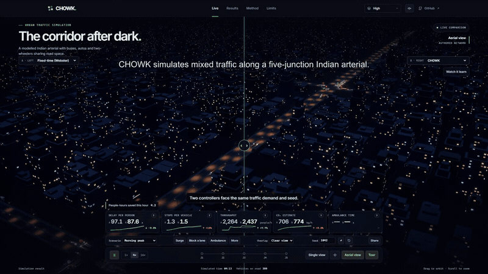
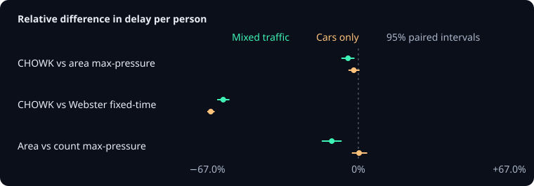
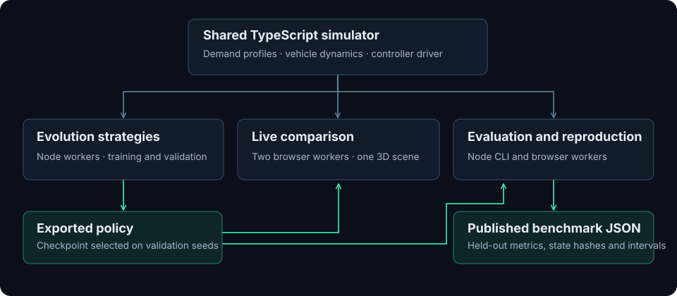

# CHOWK



**A learned traffic-signal controller for lane-free Indian traffic: a live 3D corridor in your browser, and a benchmark you can re-run in it.**

**[▶ Open the live demo](https://chowk-seven.vercel.app/)** · [Results page](https://chowk-seven.vercel.app/results) · [90-second captioned video](https://github.com/JunaidAhamed-7777/chowk/raw/refs/heads/main/assets/demo/chowk-demo.mp4) · [One-page brief (PDF)](docs/CHOWK-brief.pdf)

[](https://github.com/JunaidAhamed-7777/chowk/actions/workflows/ci.yml) [](#reproduce-every-number) [](#engineering-measurements) [](LICENSE)

*Chowk* is Hindi for a junction. On Indian roads two-wheelers filter through gaps, auto-rickshaws and buses share the same road width, and a vehicle count says little about how many people are waiting. CHOWK observes occupied road area, learns a correction to area-based max-pressure control, and is judged on delay to people, including those still queueing to enter. Bengaluru drivers alone lost 168 hours to rush-hour traffic in 2025, according to the [TomTom Traffic Index](https://www.tomtom.com/traffic-index/city/bengaluru/). It is an INNOVEX 2026 entry for PS04, Smart Cities & Sustainability. All performance figures are simulation results.

## Highlights

- **Every number below is generated.** The results section is written by `npm run bench:readme` from [results/benchmark.json](results/benchmark.json); none of it is typed by hand.
- **Held-out by construction.** Test seeds are never used for training, tuning or checkpoint choice, and one suite runs a road network the policy never saw.
- **Paired statistics throughout.** Every comparison pairs two controllers on identical traffic and reports a 95% bootstrap interval.
- **Wins ranked by size.** Every win shown is a paired comparison whose 95% interval excludes zero. The complete results, ties included, are one click below them.
- **Bit-for-bit reproducible.** Node, Chromium, WebKit and Firefox reach the same simulation state, and the Results page re-runs published episodes in your browser and checks every metric and final state hash.
- **Strong baselines.** Webster fixed-time, actuated control, and count- and area-based max-pressure get the true demand, tuned hysteresis where they use it, and pre-emption variants for ambulances. No baseline is weakened to flatter a comparison.
- **Portable policy.** The published policy also ships as dependency-free C99 that CI checks against the TypeScript outputs bit for bit. [exports/c](exports/c/)

## Contents

[Benchmark results](#benchmark-results) · [In the live demo](#in-the-live-demo) · [How it works](#how-it-works) · [Reproduce every number](#reproduce-every-number) · [Data for tools and agents](#data-for-tools-and-agents) · [Limits](#limits) · [Prior work](#prior-work) · [Repository map](#repository-map)

<!-- results:start -->

## Benchmark results

> **On 20 held-out seeds in simulated Indian mixed traffic, CHOWK reduced delay per person by 4.6% versus area max-pressure (95% CI −7.5% to −1.7%), with 60.0% lower delay versus Webster fixed-time (95% CI −62.7% to −57.2%). Simulation result.**

| Benchmark scale | |
|---|---:|
| Simulated episodes | 2,660 |
| Simulated traffic | 1,552 hours |
| Vehicles entering the measured windows | 2,558,321 |
| People in those vehicles | 9,290,288 |
| Benchmark suites | 7 (B1, B2, B3, B4, B5, B6, B7) |
| Distinct traffic conditions | 25 |
| Controllers compared | 11 |
| Held-out test seeds per condition | 20 (1,000,000–1,000,019, never used in training or checkpoint choice) |
| Paired comparisons, each with a 95% bootstrap interval | 5,644 |
| Engines reaching the identical simulation state | 4 (Node, Chromium, WebKit, Firefox) |

### Biggest wins

CHOWK's largest improvement on each metric against each baseline, on held-out seeds, largest first. Each is a paired comparison whose 95% bootstrap interval lies entirely in CHOWK's favour.

| # | Metric | Against | Condition | CHOWK's change [95% interval] |
|---:|---|---|---|---:|
| 1 | Bus-passenger delay | Fixed-time (Webster) | Morning peak · Demand at 50% | −88.0% [−89.3%, −86.6%] |
| 2 | Delay per person | Fixed-time (Webster) | Morning peak · Demand at 60% | −76.2% [−78.0%, −74.0%] |
| 3 | Maximum approach wait | Fixed-time (Webster) | Morning peak · Demand at 110% | −65.5% [−69.7%, −60.9%] |
| 4 | Bus-passenger delay | Count max-pressure | Morning peak · Demand at 50% | −62.6% [−66.6%, −58.0%] |
| 5 | Bus-passenger delay | Actuated | Morning peak · Demand at 60% | −53.8% [−56.4%, −50.8%] |
| 6 | Time with an approach over 120 s | Count max-pressure | Lane-disciplined cars | −53.1% [−59.0%, −47.3%] |
| 7 | Stops per vehicle | Fixed-time (Webster) | Morning peak · Demand at 50% | −43.7% [−46.2%, −41.3%] |
| 8 | Mean completed travel time | Fixed-time (Webster) | Lane-disciplined cars | −41.3% [−42.8%, −39.7%] |
| 9 | Time with an approach over 120 s | Area max-pressure | Morning peak · Demand at 50% | −41.3% [−46.9%, −35.1%] |
| 10 | Ambulance travel time | Fixed-time (Webster) | Morning peak · with ambulances | −41.1% [−44.0%, −38.0%] |
| 11 | Delay per person | Actuated | Morning peak · 70% two-wheelers | −36.8% [−39.1%, −34.5%] |
| 12 | Delay per person | Count max-pressure | Morning peak · Demand at 50% | −30.7% [−34.9%, −25.8%] |
| 13 | Time with an approach over 120 s | Fixed-time (Webster) | Lane-disciplined cars | −30.5% [−39.6%, −20.2%] |
| 14 | Maximum approach wait | Actuated | Morning peak · Demand at 110% | −30.1% [−39.1%, −19.2%] |
| 15 | 95th-percentile approach wait | Count max-pressure | Lane-disciplined cars | −26.3% [−29.5%, −23.3%] |

### Biggest wins against area max-pressure, the strongest baseline

The largest win on each metric, from 105 clear wins in all, largest first.

| # | Metric | Against | Condition | CHOWK's change [95% interval] |
|---:|---|---|---|---:|
| 1 | Time with an approach over 120 s | Area max-pressure | Morning peak · Demand at 50% | −41.3% [−46.9%, −35.1%] |
| 2 | 95th-percentile approach wait | Area max-pressure | Morning peak · Demand at 50% | −21.6% [−24.5%, −18.8%] |
| 3 | Delay per person | Area max-pressure | Morning peak · Demand at 50% | −11.6% [−13.9%, −9.4%] |
| 4 | Bus-passenger delay | Area max-pressure | Morning peak · Demand at 60% | −10.3% [−16.3%, −3.5%] |
| 5 | Stops per vehicle | Area max-pressure | Morning peak · Demand at 50% | −5.4% [−7.5%, −3.3%] |
| 6 | Mean completed travel time | Area max-pressure | Morning peak · Demand at 50% | −4.8% [−5.5%, −4.2%] |
| 7 | Ambulance travel time | Area max-pressure | Morning peak · with ambulances | −3.9% [−7.0%, −0.6%] |
| 8 | Maximum approach wait | Area max-pressure | Evening peak | −3.8% [−7.5%, −0.5%] |
| 9 | Estimated CO₂ | Area max-pressure | Morning peak · Demand at 50% | −1.2% [−1.5%, −0.9%] |
| 10 | Throughput | Area max-pressure | Festival | +1.1% [+0.3%, +2.0%] |
| 11 | Eligible trips completed | Area max-pressure | Morning peak · Demand surge | +0.7% [+0.3%, +1.2%] |

### Clear wins against each baseline

Each traffic condition and metric counts once across suites.

| Against | Clear wins (metric × condition) | Largest |
|---|---:|---|
| Fixed-time (Webster) | 199 | −88.0% bus-passenger delay, Morning peak · Demand at 50% |
| Actuated | 162 | −53.8% bus-passenger delay, Morning peak · Demand at 60% |
| Count max-pressure | 121 | −62.6% bus-passenger delay, Morning peak · Demand at 50% |
| Area max-pressure | 105 | −41.3% time with an approach over 120 s, Morning peak · Demand at 50% |

### Engineering measurements

| Measurement | Result |
|---|---|
| Simulator speed | 1007.7× real time with ~501 vehicles<br>291.1× real time with ~1,504 vehicles<br>138.0× real time with ~3,045 vehicles |
| Policy inference | 6.20 µs per decision |
| Cross-engine determinism | Node, Chromium, WebKit, Firefox: identical state hash `119b6db7` after 10,000 ticks |
| Benchmark replay in the browser | Chromium: 9 of 9 episodes exact in 2.52 s<br>Firefox: 9 of 9 episodes exact in 3.43 s<br>WebKit: 9 of 9 episodes exact in 2.96 s |
| Rendering | low: 163.9 fps median, 161.3 fps 1% low<br>medium: 163.9 fps median, 160.4 fps 1% low<br>high: 163.9 fps median, 158.5 fps 1% low |
| Cold load on localhost | 873.0 KiB, interactive in 1.00 s |
| Initial JavaScript | 525.8 kB compressed |
| Broadband (10 Mbps, 40 ms) | poster in 0.31 s, interactive in 1.61 s (median of 3) |
| Slow connection (2 Mbps, 150 ms) | poster in 1.17 s, interactive in 4.94 s (median of 3) |
| 3D models | 34 GLB files, 107.4 KiB in total |
| 10-minute memory soak | V8 heap 13.31 → 13.37 MiB, 2 workers |
| Tests when measured | 92 passed, 0 failed |

Measured on AMD Ryzen 9 5900HX with Radeon Graphics · AMD Radeon(TM) Graphics · win32 10.0.26300 · Node 26.8.1.

<details>
<summary><strong>Complete results</strong>: every scenario, metric and suite, including ties and the conditions where a baseline does better</summary>

#### Delay per person: CHOWK against every baseline, in every scenario

Each cell pairs the two controllers on the same held-out seeds: the mean relative difference in delay per person and its 95% paired bootstrap interval. ✅ CHOWK clearly lower (the interval excludes zero) · ➖ no clear difference · ❌ CHOWK clearly higher.

| Scenario | vs Area max-pressure | vs Count max-pressure | vs Actuated | vs Fixed-time (Webster) |
|---|---:|---:|---:|---:|
| Morning peak | −4.6% [−7.5%, −1.7%] ✅ | −15.8% [−20.8%, −11.1%] ✅ | −32.9% [−36.5%, −29.2%] ✅ | −60.0% [−62.7%, −57.2%] ✅ |
| Evening peak | −2.1% [−5.1%, +1.4%] ➖ | −12.4% [−16.2%, −8.4%] ✅ | −29.6% [−33.6%, −25.5%] ✅ | −51.5% [−54.4%, −48.4%] ✅ |
| Off-peak | −5.1% [−7.4%, −2.5%] ✅ | −29.7% [−32.6%, −26.5%] ✅ | −32.6% [−34.5%, −30.5%] ✅ | −75.4% [−77.2%, −73.4%] ✅ |
| Festival | −1.8% [−5.2%, +1.6%] ➖ | −13.9% [−17.7%, −10.2%] ✅ | −8.3% [−12.9%, −4.0%] ✅ | −32.1% [−36.1%, −28.0%] ✅ |
| Monsoon | +0.7% [−3.5%, +4.8%] ➖ | −12.6% [−17.8%, −7.3%] ✅ | −23.8% [−28.1%, −20.0%] ✅ | −54.2% [−57.7%, −50.9%] ✅ |
| Oversaturated | −1.3% [−4.3%, +1.8%] ➖ | −5.8% [−9.5%, −2.2%] ✅ | −8.6% [−11.5%, −5.8%] ✅ | −35.0% [−38.1%, −31.8%] ✅ |
| Lane-disciplined cars | −2.0% [−4.4%, +0.5%] ➖ | −1.7% [−4.8%, +1.6%] ➖ | −29.0% [−32.5%, −25.2%] ✅ | −65.5% [−67.0%, −63.8%] ✅ |

#### Scoreboard: every metric, every distinct traffic condition

The number of traffic conditions in which CHOWK came out clearly better, with no clear difference, or clearly worse than each baseline. Each condition counts once across suites. Intervals are per comparison and not adjusted for multiple comparisons.

| Metric | vs Area max-pressure | vs Count max-pressure | vs Actuated | vs Fixed-time (Webster) |
|---|:---:|:---:|:---:|:---:|
| Delay per person (lower is better) | ✅ 9 · ➖ 16 · ❌ 0 | ✅ 23 · ➖ 1 · ❌ 0 | ✅ 24 · ➖ 0 · ❌ 0 | ✅ 25 · ➖ 0 · ❌ 0 |
| Bus-passenger delay (lower is better) | ✅ 6 · ➖ 18 · ❌ 0 | ✅ 23 · ➖ 0 · ❌ 0 | ✅ 23 · ➖ 0 · ❌ 0 | ✅ 24 · ➖ 0 · ❌ 0 |
| Stops per vehicle (lower is better) | ✅ 7 · ➖ 18 · ❌ 0 | ✅ 0 · ➖ 1 · ❌ 23 | ✅ 22 · ➖ 2 · ❌ 0 | ✅ 23 · ➖ 1 · ❌ 1 |
| Throughput (higher is better) | ✅ 2 · ➖ 22 · ❌ 1 | ✅ 6 · ➖ 18 · ❌ 0 | ✅ 18 · ➖ 6 · ❌ 0 | ✅ 25 · ➖ 0 · ❌ 0 |
| Estimated CO₂ (lower is better) | ✅ 12 · ➖ 13 · ❌ 0 | ✅ 14 · ➖ 10 · ❌ 0 | ✅ 23 · ➖ 1 · ❌ 0 | ✅ 25 · ➖ 0 · ❌ 0 |
| Mean completed travel time (lower is better) | ✅ 12 · ➖ 13 · ❌ 0 | ✅ 0 · ➖ 5 · ❌ 19 | ✅ 21 · ➖ 1 · ❌ 2 | ✅ 25 · ➖ 0 · ❌ 0 |
| Eligible trips completed (higher is better) | ✅ 3 · ➖ 22 · ❌ 0 | ✅ 0 · ➖ 18 · ❌ 6 | ✅ 19 · ➖ 4 · ❌ 1 | ✅ 25 · ➖ 0 · ❌ 0 |
| Maximum approach wait (lower is better) | ✅ 6 · ➖ 19 · ❌ 0 | ✅ 9 · ➖ 15 · ❌ 0 | ✅ 12 · ➖ 5 · ❌ 7 | ✅ 23 · ➖ 2 · ❌ 0 |
| 95th-percentile approach wait (lower is better) | ✅ 23 · ➖ 2 · ❌ 0 | ✅ 23 · ➖ 1 · ❌ 0 | ✅ 0 · ➖ 0 · ❌ 24 | ✅ 1 · ➖ 6 · ❌ 18 |
| Time with an approach over 120 s (lower is better) | ✅ 24 · ➖ 1 · ❌ 0 | ✅ 23 · ➖ 1 · ❌ 0 | ✅ 0 · ➖ 0 · ❌ 24 | ✅ 2 · ➖ 6 · ❌ 17 |

#### Morning peak, every controller

Mean [95% bootstrap interval] over the held-out seeds.

| Controller | Delay per person (s) | Stops per vehicle | Throughput (people/h) | Estimated CO₂ (kg) |
|---|---:|---:|---:|---:|
| CHOWK | 84.0 [75.1, 93.3] | 2.40 [2.30, 2.51] | 6282 [6034, 6517] | 241.3 [233.1, 249.2] |
| Area max-pressure | 88.0 [79.2, 97.3] | 2.43 [2.33, 2.53] | 6285 [6028, 6518] | 242.8 [234.5, 250.8] |
| Count max-pressure | 99.8 [91.8, 107.8] | 2.15 [2.04, 2.27] | 6244 [5982, 6484] | 242.4 [233.9, 250.6] |
| Actuated | 125.1 [113.4, 137.4] | 2.94 [2.82, 3.04] | 6092 [5850, 6316] | 250.0 [241.3, 258.3] |
| Fixed-time (Webster) | 209.7 [192.7, 226.1] | 3.21 [3.10, 3.31] | 5571 [5336, 5787] | 264.1 [254.5, 273.2] |



#### Every suite

| Suite | Name | What it tests | Conditions | Controllers | Episodes | CHOWK vs area max-pressure, delay per person |
|---|---|---|---:|---:|---:|:---:|
| B1 | Main comparison | Seven traffic scenarios, five controllers | 7 | 5 | 700 | ✅ 2 · ➖ 5 · ❌ 0 |
| B2 | Lane-free effect | Mixed traffic against lane-disciplined cars | 2 | 5 | 200 | ✅ 1 · ➖ 1 · ❌ 0 |
| B3 | Policy ablations | CHOWK against variants with one design choice removed | 2 | 5 | 200 | — |
| B4 | Generalisation | Demand from 50% to 120%, unseen vehicle mixes, a held-out grid | 11 | 5 | 1,100 | ✅ 5 · ➖ 6 · ❌ 0 |
| B5 | Robustness | Sensor noise, frozen sensors, a blocked lane, a demand surge | 7 | 5 | 700 | ✅ 2 · ➖ 5 · ❌ 0 |
| B6 | Emergency response | Ambulances, with and without signal pre-emption | 1 | 5 | 100 | ✅ 1 · ➖ 0 · ❌ 0 |
| B7 | Fairness | Longest and 95th-percentile waits, starved approaches | 7 | 5 | 700 | ✅ 2 · ➖ 5 · ❌ 0 |

<details>
<summary><strong>B2 · Lane-free effect</strong>: Mixed traffic against lane-disciplined cars</summary>

Delay per person, CHOWK against each baseline. The same demand runs once as Indian mixed traffic and once as lane-disciplined cars.

| Traffic | vs Area max-pressure | vs Count max-pressure | vs Actuated | vs Fixed-time (Webster) |
|---|---:|---:|---:|---:|
| Morning peak | −4.6% [−7.5%, −1.7%] ✅ | −15.8% [−20.8%, −11.1%] ✅ | −32.9% [−36.5%, −29.2%] ✅ | −60.0% [−62.7%, −57.2%] ✅ |
| Lane-disciplined cars | −2.0% [−4.4%, +0.5%] ➖ | −1.7% [−4.8%, +1.6%] ➖ | −29.0% [−32.5%, −25.2%] ✅ | −65.5% [−67.0%, −63.8%] ✅ |

</details>

<details>
<summary><strong>B3 · Policy ablations</strong>: CHOWK against variants with one design choice removed</summary>

Delay per person, CHOWK against variants that each remove one design choice. The variants come from separate, shorter training runs; every policy sees the same held-out demand and seeds.

| Scenario | vs CHOWK · vehicle objective | vs CHOWK · count observation | vs CHOWK · pure policy | vs CHOWK · isolated junction |
|---|---:|---:|---:|---:|
| Morning peak | −1.0% [−5.8%, +4.3%] ➖ | −11.7% [−17.3%, −5.8%] ✅ | −77.2% [−79.3%, −74.9%] ✅ | −0.7% [−7.1%, +5.2%] ➖ |
| Festival | −5.1% [−8.2%, −2.0%] ✅ | −13.1% [−17.0%, −9.3%] ✅ | −57.0% [−60.4%, −53.5%] ✅ | +0.2% [−3.4%, +3.8%] ➖ |

</details>

<details>
<summary><strong>B4 · Generalisation</strong>: Demand from 50% to 120%, unseen vehicle mixes, a held-out grid</summary>

Delay per person, CHOWK against each baseline under each condition.

| Condition | vs Area max-pressure | vs Count max-pressure | vs Actuated | vs Fixed-time (Webster) |
|---|---:|---:|---:|---:|
| Demand at 50% | −11.6% [−13.9%, −9.4%] ✅ | −30.7% [−34.9%, −25.8%] ✅ | −17.6% [−22.8%, −12.0%] ✅ | −76.0% [−78.5%, −73.1%] ✅ |
| Demand at 60% | −9.3% [−11.8%, −6.5%] ✅ | −29.0% [−33.5%, −24.1%] ✅ | −27.8% [−30.3%, −24.8%] ✅ | −76.2% [−78.0%, −74.0%] ✅ |
| Demand at 70% | −8.0% [−11.1%, −5.0%] ✅ | −27.5% [−30.9%, −24.4%] ✅ | −32.7% [−35.6%, −29.8%] ✅ | −75.8% [−77.1%, −74.1%] ✅ |
| Demand at 80% | −3.4% [−7.3%, +0.5%] ➖ | −22.5% [−27.4%, −17.3%] ✅ | −34.8% [−37.9%, −31.8%] ✅ | −70.9% [−73.2%, −68.5%] ✅ |
| Demand at 90% | −2.5% [−8.7%, +4.2%] ➖ | −17.1% [−22.4%, −11.8%] ✅ | −32.1% [−35.9%, −28.1%] ✅ | −63.4% [−66.3%, −60.3%] ✅ |
| Demand at 100% | −6.6% [−10.9%, −1.6%] ✅ | −17.1% [−21.3%, −12.9%] ✅ | −29.8% [−32.7%, −26.6%] ✅ | −55.5% [−58.0%, −53.0%] ✅ |
| Demand at 110% | +0.6% [−4.0%, +5.7%] ➖ | −7.1% [−11.9%, −1.9%] ✅ | −21.4% [−25.0%, −17.8%] ✅ | −52.1% [−55.3%, −48.9%] ✅ |
| Demand at 120% | −1.1% [−4.1%, +1.9%] ➖ | −8.0% [−11.6%, −4.5%] ✅ | −15.8% [−18.7%, −12.7%] ✅ | −44.3% [−47.4%, −41.4%] ✅ |
| 70% two-wheelers | −3.8% [−6.9%, −0.3%] ✅ | −18.6% [−23.6%, −13.3%] ✅ | −36.8% [−39.1%, −34.5%] ✅ | −57.9% [−60.2%, −55.7%] ✅ |
| 15% buses | +0.1% [−5.2%, +6.2%] ➖ | −9.4% [−14.0%, −4.6%] ✅ | −14.8% [−18.9%, −10.7%] ✅ | −49.4% [−53.0%, −45.9%] ✅ |
| Held-out grid (never trained on) | −1.2% [−4.7%, +2.2%] ➖ | −20.5% [−23.8%, −17.3%] ✅ | −9.2% [−12.3%, −5.6%] ✅ | −43.4% [−46.5%, −39.8%] ✅ |

</details>

<details>
<summary><strong>B5 · Robustness</strong>: Sensor noise, frozen sensors, a blocked lane, a demand surge</summary>

Delay per person, CHOWK against each baseline under each condition.

| Condition | vs Area max-pressure | vs Count max-pressure | vs Actuated | vs Fixed-time (Webster) |
|---|---:|---:|---:|---:|
| Clean sensors | −4.6% [−7.5%, −1.7%] ✅ | −15.8% [−20.8%, −11.1%] ✅ | −32.9% [−36.5%, −29.2%] ✅ | −60.0% [−62.7%, −57.2%] ✅ |
| 10% sensor noise | −3.8% [−8.4%, +1.5%] ➖ | −18.3% [−23.0%, −13.9%] ✅ | −31.8% [−35.2%, −28.2%] ✅ | −59.2% [−61.2%, −57.1%] ✅ |
| 20% sensor noise | +0.5% [−5.0%, +6.4%] ➖ | −13.6% [−18.9%, −8.3%] ✅ | −28.6% [−32.1%, −24.9%] ✅ | −56.6% [−59.4%, −53.8%] ✅ |
| 30% sensor noise | −3.5% [−7.7%, +0.6%] ➖ | −14.3% [−17.6%, −10.4%] ✅ | −29.8% [−33.0%, −27.0%] ✅ | −56.2% [−57.9%, −54.4%] ✅ |
| Frozen sensors | +2.8% [−3.2%, +8.7%] ➖ | −12.6% [−16.8%, −8.4%] ✅ | −23.2% [−27.7%, −18.3%] ✅ | −52.6% [−55.6%, −49.6%] ✅ |
| Blocked lane | +0.4% [−4.5%, +5.5%] ➖ | −11.0% [−15.6%, −6.2%] ✅ | −14.9% [−20.2%, −9.8%] ✅ | −34.6% [−39.2%, −29.8%] ✅ |
| Demand surge | −7.5% [−11.5%, −3.3%] ✅ | −17.9% [−22.1%, −13.8%] ✅ | −32.8% [−36.0%, −29.5%] ✅ | −60.9% [−63.1%, −58.5%] ✅ |

</details>

<details>
<summary><strong>B6 · Emergency response</strong>: Ambulances, with and without signal pre-emption</summary>

Ambulance travel time is measured on completed trips; the completion count and everyone else's delay show the trade-off.

| Controller | Ambulance travel time (s) | Ambulances completed | Delay per person (s) |
|---|---:|---:|---:|
| CHOWK | 272.3 [262.2, 282.3] | 5.5 [5.3, 5.7] | 85.4 [76.5, 94.6] |
| Area max-pressure | 283.3 [272.9, 293.5] | 5.4 [5.2, 5.6] | 88.8 [79.8, 98.2] |
| Fixed-time (Webster) | 462.7 [436.1, 489.1] | 4.2 [4.0, 4.4] | 215.8 [198.5, 232.8] |
| Area max-pressure with pre-emption | 239.5 [228.9, 252.6] | 5.6 [5.4, 5.8] | 91.0 [82.1, 100.5] |
| CHOWK with pre-emption | 235.6 [223.3, 250.6] | 5.7 [5.5, 5.9] | 86.1 [77.8, 94.7] |

Ambulance travel time, CHOWK (without pre-emption) against each alternative:

| Scenario | vs Area max-pressure | vs Fixed-time (Webster) | vs Area max-pressure with pre-emption | vs CHOWK with pre-emption |
|---|---:|---:|---:|---:|
| Morning peak | −3.9% [−7.0%, −0.6%] ✅ | −41.1% [−44.0%, −38.0%] ✅ | +13.7% [+9.5%, +18.3%] ❌ | +15.6% [+10.8%, +20.2%] ❌ |

</details>

<details>
<summary><strong>B7 · Fairness</strong>: Longest and 95th-percentile waits, starved approaches</summary>

95th-percentile wait on an approach, CHOWK against each baseline. The scoreboard also counts the longest wait and the share of time with an approach waiting over 120 s.

| Scenario | vs Area max-pressure | vs Count max-pressure | vs Actuated | vs Fixed-time (Webster) |
|---|---:|---:|---:|---:|
| Morning peak | −6.7% [−8.6%, −4.9%] ✅ | −12.1% [−14.5%, −9.8%] ✅ | +48.5% [+43.1%, +54.5%] ❌ | +18.3% [+15.0%, +22.1%] ❌ |
| Evening peak | −4.5% [−5.7%, −3.2%] ✅ | −8.8% [−10.4%, −7.2%] ✅ | +42.3% [+36.2%, +49.0%] ❌ | +18.0% [+12.8%, +22.8%] ❌ |
| Off-peak | −17.0% [−18.5%, −15.4%] ✅ | −23.8% [−26.1%, −21.3%] ✅ | +91.9% [+85.6%, +98.4%] ❌ | −0.7% [−9.8%, +9.8%] ➖ |
| Festival | −1.9% [−3.0%, −0.7%] ✅ | −3.6% [−5.1%, −2.3%] ✅ | +15.5% [+11.6%, +19.4%] ❌ | −1.9% [−7.6%, +4.2%] ➖ |
| Monsoon | −3.3% [−4.5%, −2.0%] ✅ | −8.0% [−10.1%, −5.8%] ✅ | +33.8% [+29.9%, +38.2%] ❌ | +4.7% [−0.7%, +9.5%] ➖ |
| Oversaturated | −1.2% [−3.0%, +0.7%] ➖ | −3.4% [−7.9%, −0.3%] ✅ | +11.0% [+6.1%, +16.1%] ❌ | −4.0% [−12.2%, +4.4%] ➖ |
| Lane-disciplined cars | −11.4% [−13.3%, −9.6%] ✅ | −26.3% [−29.5%, −23.3%] ✅ | +33.4% [+29.5%, +37.1%] ❌ | −7.3% [−11.5%, −3.0%] ✅ |

</details>

</details>

All values are simulation results. [Full benchmark and provenance](results/benchmark.md) · [Raw runs, summaries and comparisons as JSON](results/benchmark.json)

<!-- results:end -->

## In the live demo

| Try | What happens |
|---|---|
| **Compare controllers** | Drag the divider: both sides get identical vehicles, only the signals differ. Swap either controller while traffic keeps moving. [Clip](assets/demo/wipe.gif) |
| **Break it** | Trigger a demand surge, block a lane with a stalled bus, or send an ambulance. Each event starts at the same tick on both sides. [Surge](assets/demo/surge.gif) · [Ambulance](assets/demo/ambulance.gif) |
| **See what it sees** | The Pressure overlay shows occupied road area; Decision shows what each controller scored. Watch it learn swaps in a saved training checkpoint mid-run. [Clip](assets/demo/decisions.gif) |
| **Ask why** | How it decides walks through a junction's latest decision and the inputs that moved CHOWK's learned correction most, and checks the browser's arithmetic against the controller. |
| **Beat the AI** | Run junction J3 by hand against CHOWK for three simulated minutes on the same traffic. |
| **Read it like an engineer** | Time-space draws a live trajectory diagram for both simulations, with each junction's green. |
| **Rewind** | Return both simulations a minute and replay exactly, then change a controller or an event and watch a different future. |
| **Check the numbers** | Results re-runs the benchmark in your browser and compares every metric and final state hash, or replays any single published seed. [Clip](assets/demo/reproduce.gif) |

## How it works



- **Simulator.** One deterministic TypeScript package powers the live workers, training and the benchmark. Lane-free filtering emerges from longitudinal car following and lateral strip changes. No `Math.random`, no wall clock and fixed iteration orders keep runs identical on every engine.
- **Controller.** CHOWK adds a small learned correction to area-based max-pressure. The baseline and CHOWK share the same phase mask and starvation guard, so the comparison isolates what was learned.
- **Training.** Evolution strategies optimise occupancy-weighted delay on training seeds. Validation seeds choose checkpoints. Held-out test seeds are touched only by the benchmark.
- **Evaluation.** Seven suites pair every controller by seed and report bootstrap intervals for the differences. A fingerprint of the simulator, controllers and scenarios is stored with the results, and the build fails if the published benchmark no longer matches the code.

## Reproduce every number

Use Node.js 22.12 or later. From a clean checkout:

```sh
npm ci
npm test                           # unit tests
npm run bench -- --suite B1        # re-run the main suite on the held-out seeds
npm run bench:all                  # every suite
npm run bench:readme               # regenerate the results section above and results/benchmark.md
```

`npm run dev` starts the app; `/debug` gives a top-down view with tick-by-tick playback. `npm run build` verifies the published benchmark against the source fingerprint, type-checks every workspace and builds the static app. For the browser suites, run `npm exec -- playwright install`, then `npm run test:browsers`. [Published run provenance](results/benchmark.md#provenance)

## Data for tools and agents

Everything on this page can be checked mechanically.

| File | Contents |
|---|---|
| [results/benchmark.json](results/benchmark.json) | `meta` (commit, simulator fingerprint, policy hashes, seeds), `runs[]` (one record per episode with all metrics and the final state hash), `summary[]` (mean, median and 95% interval per controller and metric), `comparisons[]` (paired relative difference, interval, win rate, `clear`), `headline`, `engineering` |
| [results/benchmark.md](results/benchmark.md) | Every suite, scenario and variant as tables, plus provenance |
| [results/validation.json](results/validation.json) | Simulator validation: fundamental diagram, queue discharge, filtering, invariants and twin-demand checks |
| [results/calibration.json](results/calibration.json) | Measured saturation flows by vehicle mix and road width |
| [results/engineering.json](results/engineering.json) | Speed, determinism, rendering, load and memory measurements |

## Limits

All performance comparisons are simulation results. The corridor geometry, driving parameters and detector behaviour use documented assumptions. The model omits pedestrians and parking, and the emissions estimate is illustrative. Its turning model is conservative: junctions with turning traffic discharge well below Indo-HCM's base saturation flows for the same widths, as the Limits page shows. Several comparisons show no clear difference and some favour a baseline; the complete results section shows each one. A field study would need measured demand, calibration and independent safety validation.

## Prior work

CHOWK builds on work on signal control for lane-free traffic. Its contribution is a corridor-scale simulator, a learned correction to area-based max-pressure and a live comparison with an exact browser replay. [Nandakumar, Banerjee and Vanajakshi](https://arxiv.org/abs/2509.21745) · [C-DAC’s CoSiCoSt-EnV](https://cdac.in/index.aspx?id=product_details&productId=CoSiCoStEnV%28CompositeSignalControlStrategyEnhancedVersion%29)

## Repository map

| Path | Contents |
|---|---|
| [packages/sim](packages/sim/) | Deterministic lane-free traffic simulator, zero runtime dependencies |
| [packages/controllers](packages/controllers/) | Webster, actuated, max-pressure and CHOWK; hand-written policy inference |
| [packages/scenarios](packages/scenarios/) | Demand scenarios and calibration |
| [packages/train](packages/train/) | Evolution-strategies training |
| [packages/bench](packages/bench/) | Suites, paired statistics, provenance and the generated reports |
| [apps/web](apps/web/) | The browser app: React, three.js, simulation workers |
| [results](results/) | Published benchmark, validation and engineering measurements |
| [exports/c](exports/c/) | The policy as dependency-free C99, checked in CI |
| [tests/browser](tests/browser/) | Playwright determinism, live-view and results tests |
| [assets](assets/) | Blender scripts, models, demo media and [credits](assets/CREDITS.md) |

## Credits and licences

Source code is MIT-licensed. The asset credits list the model, font and media licences. [MIT licence](LICENSE) · [Asset credits](assets/CREDITS.md)

## Team

Maintained by [Junaid Ahamed](https://github.com/JunaidAhamed-7777).
