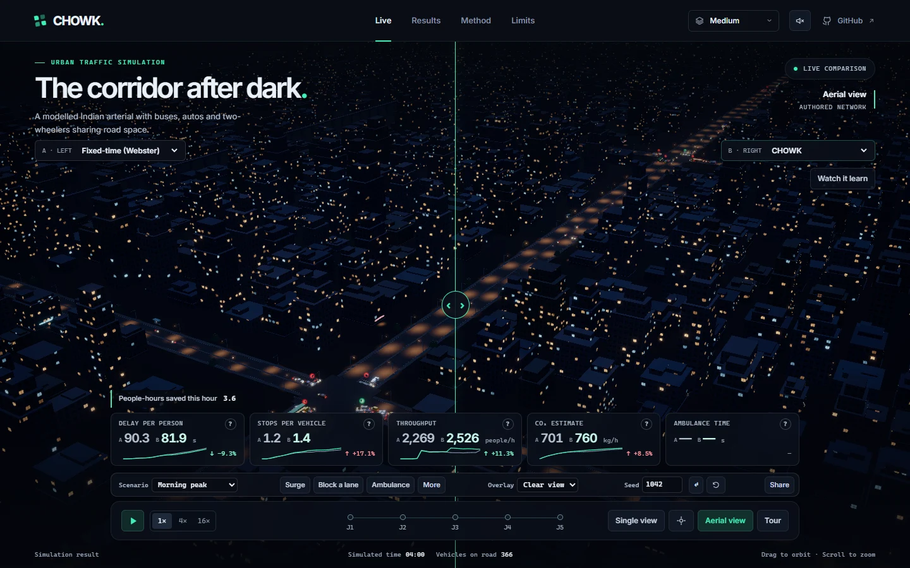

# CHOWK



**A learned signal controller for lane-free Indian traffic, running live in a browser.**

[](https://github.com/JunaidAhamed-7777/chowk/actions/workflows/ci.yml) [](LICENSE)

*Chowk* is Hindi for a junction. Most adaptive signal research assumes cars queue in lanes. Indian traffic does not: two-wheelers filter to the front, autos and buses share road width, and a queue is an area of road, not a count of cars.

CHOWK is a learned signal controller for that kind of traffic, a lane-free traffic simulator that runs in the browser, a 3D night city to watch and disrupt it in, and a benchmark any visitor can re-run.

An entry for INNOVEX 2026, problem statement PS04 (Smart Cities & Sustainability).

## The live demo

The tour opens on a fictional five-junction arterial at night. Drag the divider to compare controllers on matched demand, trigger a surge or lane closure, or send an ambulance through both simulations. The pressure overlay shows the road occupancy the controller sees.

<!-- results:start -->
<!-- results:end -->

## Why lane-free traffic matters

Cars, buses and two-wheelers occupy different amounts of road space and carry different numbers of people. CHOWK measures occupied road area and trains against delay to people, including those still waiting to enter the network. TomTom estimates that Bengaluru drivers lost 168 hours to rush-hour traffic in 2025. [TomTom Traffic Index](https://www.tomtom.com/traffic-index/city/bengaluru/)

## How it works


- **Simulator.** The same deterministic TypeScript package powers the live workers, training and benchmark. Lane-free filtering emerges from longitudinal car following and lateral strip changes.
- **Controller.** CHOWK adds a small learned adjustment to area-based max-pressure. Both the baseline and CHOWK use the same phase mask and starvation guard.
- **Training.** Evolution strategies optimise occupancy-weighted delay. Validation seeds select checkpoints. A separate set of held-out seeds supplies the published comparisons.
- **Evaluation.** Results pairs the controllers by seed and reports uncertainty. The browser replay runs a subset of the published benchmark and checks the metrics and state hashes.

## Run locally

With Node.js 22.12 or later in the 22.x series:

```sh
npm ci
npm test
npm run dev
```

Run `npm run build` to type-check the workspaces and build the static app in `apps/web/dist`.

Open `/debug` on the dev server for a top-down view with tick-by-tick playback. Run `npm test` for the simulator tests. To run the desktop smoke tests, install Chromium with `npx playwright install chromium` and run `npm run test:browsers`.

`npm run bench:smoke` exercises both the benchmark CLI and simulator on a validation seed. `npm run bench -- --suite B1` runs the full held-out comparison against the committed policy from a clean checkout. The Results view runs the shorter nine-episode replay in the browser.

## Where to look

| | |
|---|---|
| [plan/00-vision.md](plan/00-vision.md) | What is being built and why |
| [ROADMAP.md](ROADMAP.md) | Ordered tasks |
| [AGENTS.md](AGENTS.md) | Rules for AI agents working here |
| [plan/](plan/) | Full specifications |
| [docs/](docs/) | How the idea was chosen |

## Prior work

CHOWK builds on existing work on signal control for lane-free traffic. [Nandakumar, Banerjee and Vanajakshi](https://arxiv.org/abs/2509.21745) · [C-DAC’s CoSiCoSt-EnV](https://cdac.in/index.aspx?id=product_details&productId=CoSiCoStEnV%28CompositeSignalControlStrategyEnhancedVersion%29)

## Limits and credits

All performance comparisons are simulation results. The road geometry and driving parameters are authored assumptions. The simulator does not model pedestrians or field detectors, and the emissions model is illustrative. See Limits in the app and [asset credits](assets/CREDITS.md).
